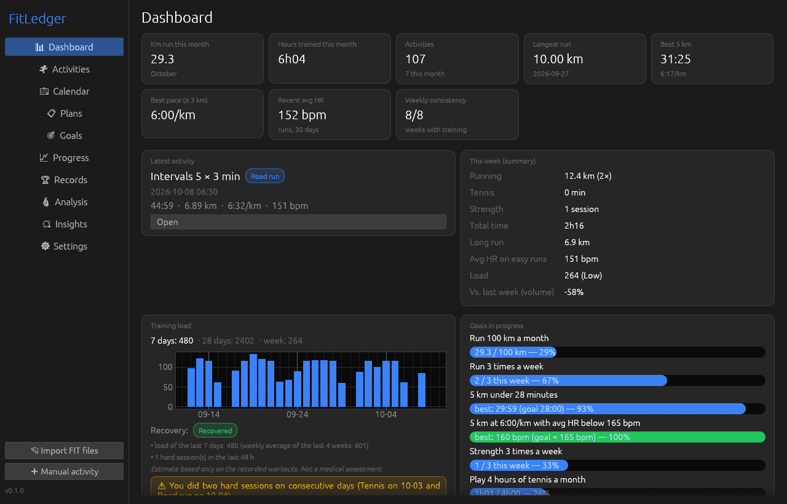
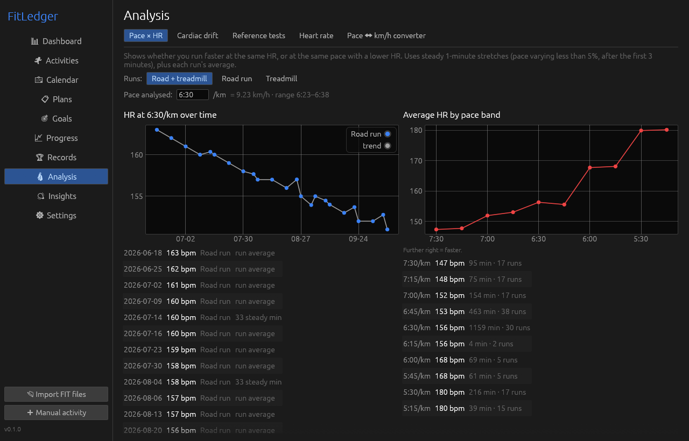
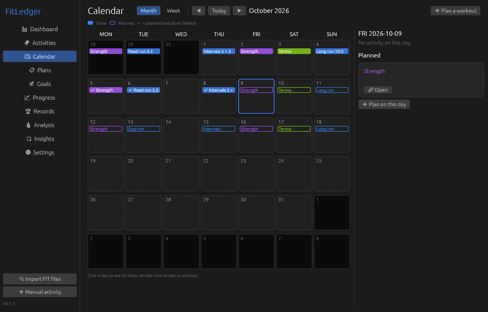
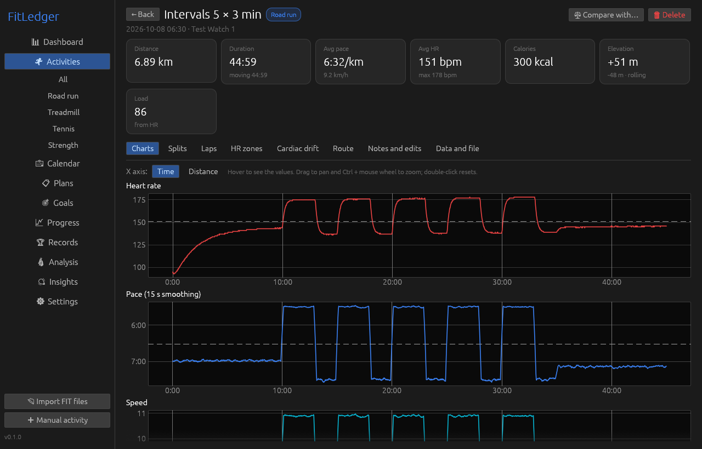
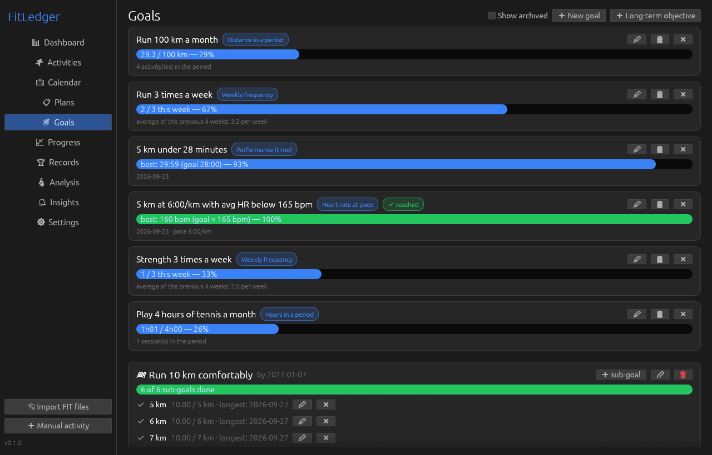
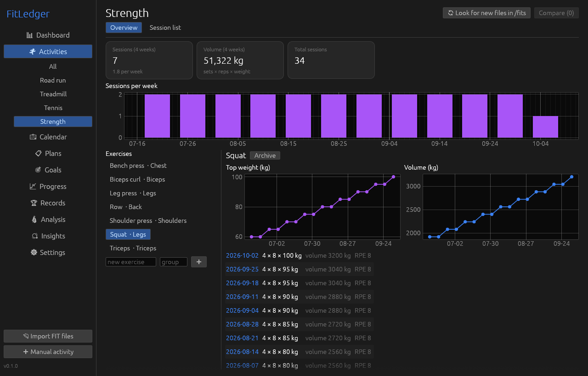
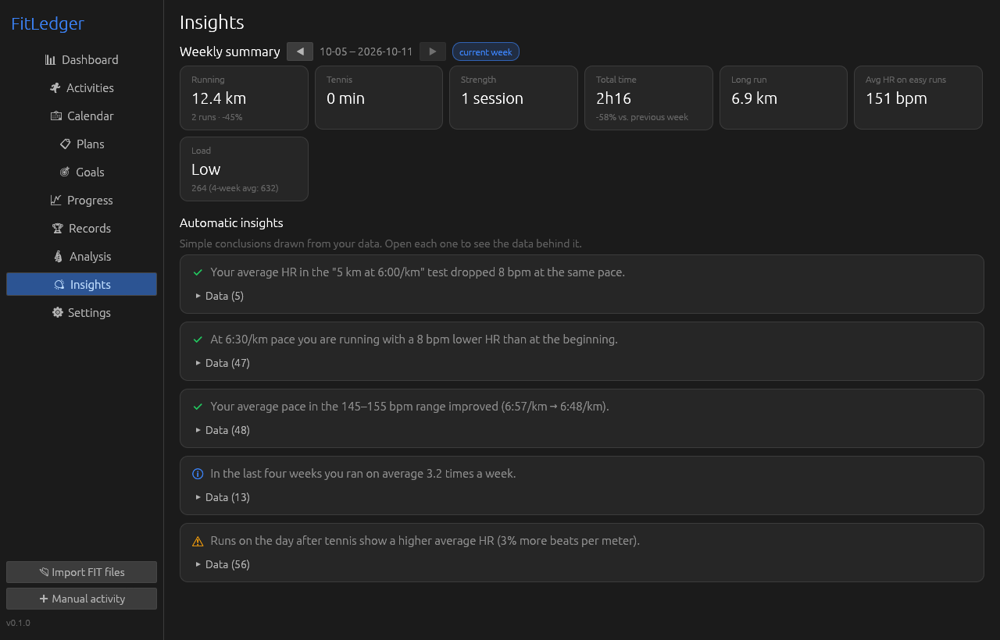

<p align="center"></p>

<h1 align="center">FitLedger</h1>

<p align="center">
A local sports diary for Windows: reads your watch's <code>.fit</code> files and turns them into
analysis of runs, treadmill sessions, tennis and strength training — progress, goals and plans.
<br><br>
<a href="https://github.com/Antxj/FitLedger/releases/latest"><b>⬇ Download FitLedger.exe</b></a>
&nbsp;·&nbsp; <a href="README.pt-BR.md">Leia em português</a>
</p>



## What it does

- **Automatic FIT import.** Put `.fit` files in the `fits` folder next to `FitLedger.exe`; new
  files are imported every time the app opens (or use *Import FIT files*). Duplicates are detected,
  a broken file never stops the others, and the original files are never changed.
- **Everything the watch recorded:** heart rate, pace, speed, cadence, altitude, GPS, power,
  temperature, laps, pauses — plus the original file kept inside the database.
- **Activity detail** with linked charts (hover to see values), splits per 500 m / 1 km / mile /
  any distance, laps, heart-rate zones, cardiac drift, route and data-quality report.
- **Pace × heart rate**: are you running faster at the same HR, or at the same pace with a lower HR?
  Uses steady 1-minute stretches, grouped by pace band, over time.
- **Cardiac drift (Pa:HR decoupling)** and **reference tests** (e.g. 5 km at 6:00/km on the
  treadmill at 1%) with HR per km for each execution.
- **Treadmill** kept apart from road running, with incline and corrected distance.
- **Training load** (TRIMP from heart rate, or RPE × minutes), 7/28-day load, simple warnings and a
  recovery estimate. Tennis counts: a hard match is not a rest day. *No medical diagnosis.*
- **Plans and calendar**: weekly template, planned vs done, structured intervals with repeated
  blocks and the treadmill speed for every target pace.
- **Goals** (distance, frequency, time, HR at pace, longest distance, hours) and long-term
  objectives with sub-goals.
- **Strength training** (sets × reps × weight, history and volume per exercise) and a **tennis** area.
- **Progress, records, weekly summary and insights** — each insight shows the data behind it.
- **Comparisons** of two or more activities that warn about treadmill vs road, terrain, distance
  and temperature differences.
- **Backup/restore** (one `.fitledger` file), **CSV/JSON export**, Portuguese and English, light
  and dark themes.

| Pace × HR | Calendar | Activity |
|---|---|---|
|  |  |  |
| **Goals** | **Strength** | **Insights** |
|  |  |  |

*Screenshots use made-up demo data.*

## Getting started

1. Download `FitLedger.exe` from the [latest release](https://github.com/Antxj/FitLedger/releases/latest)
   and put it in a folder of its own where you can write files (e.g. `Documents\FitLedger`) —
   not in `Program Files`.
2. Open it. It creates two folders next to the executable:
   - `fits\` — copy your `.fit` files here (Garmin, Coros, Zepp/Amazfit, Suunto, Polar exports…);
   - `data\` — your history (`fitledger.db`) and automatic backups.
3. **Deleting the app folder deletes your history.** Use *Settings → Create backup* now and then.

The release is not code-signed yet, so Windows SmartScreen may warn the first time
(*More info → Run anyway*). You can check the file against the SHA-256 in the release notes, or
verify where it was built:

```bash
gh attestation verify FitLedger.exe --repo Antxj/FitLedger
```

## Privacy

- Everything stays on your computer. **No telemetry, no account, no cloud.**
- The only network access is the update check: once a day the app asks the public GitHub API for
  the latest release (you can turn it off in *Settings*). Updates are only installed when you click,
  after the SHA-256 published by GitHub is checked.
- Routes are drawn from your GPS points without downloading any map.

## Building

Requirements: Rust (stable, GNU toolchain) and MinGW-w64 (`gcc` and `windres`, e.g. from MSYS2).

```bash
cargo test
```

```bash
powershell -ExecutionPolicy Bypass -File build-release.ps1
```

`build-release.ps1` runs the tests, builds `target\release\fitledger.exe` without local paths
inside the binary, checks it and prints its SHA-256 — the same script runs on GitHub Actions.
Useful environment variables for development: `FITLEDGER_HOME` (base folder instead of the exe
folder), `FITLEDGER_DEMO=1` with `FITLEDGER_SCREENSHOTS=<folder>` (fake data and screenshots,
see `tools/screenshots.py`), `FITLEDGER_LANGUAGE=pt|en`.

## License

GPL-3.0-or-later — see [LICENSE](LICENSE). Third-party components: [THIRD-PARTY-LICENSES.txt](THIRD-PARTY-LICENSES.txt).
Security issues: see [SECURITY.md](SECURITY.md).
