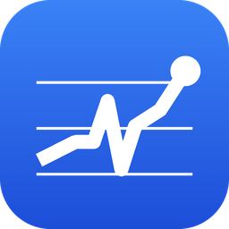
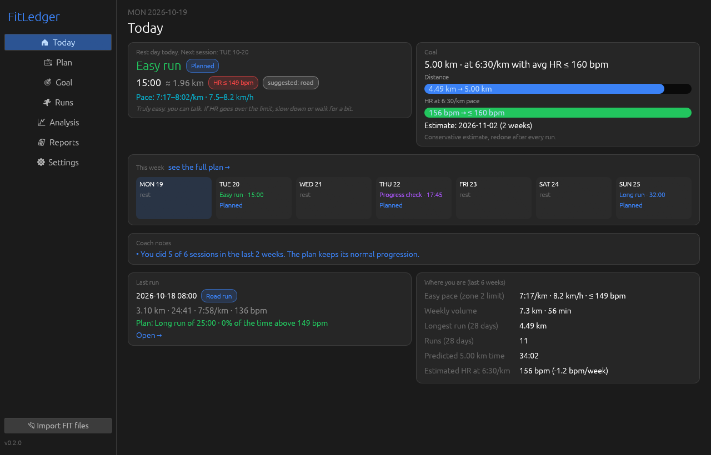
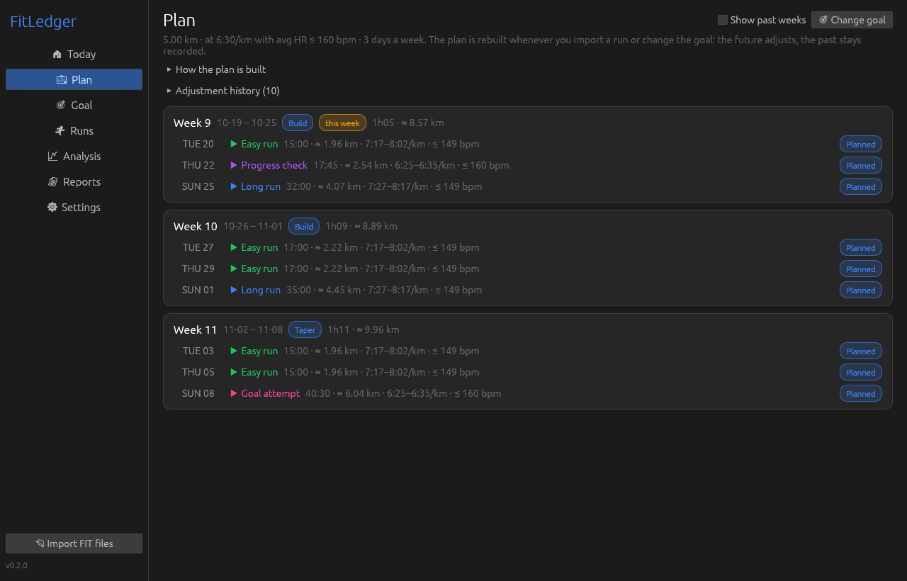
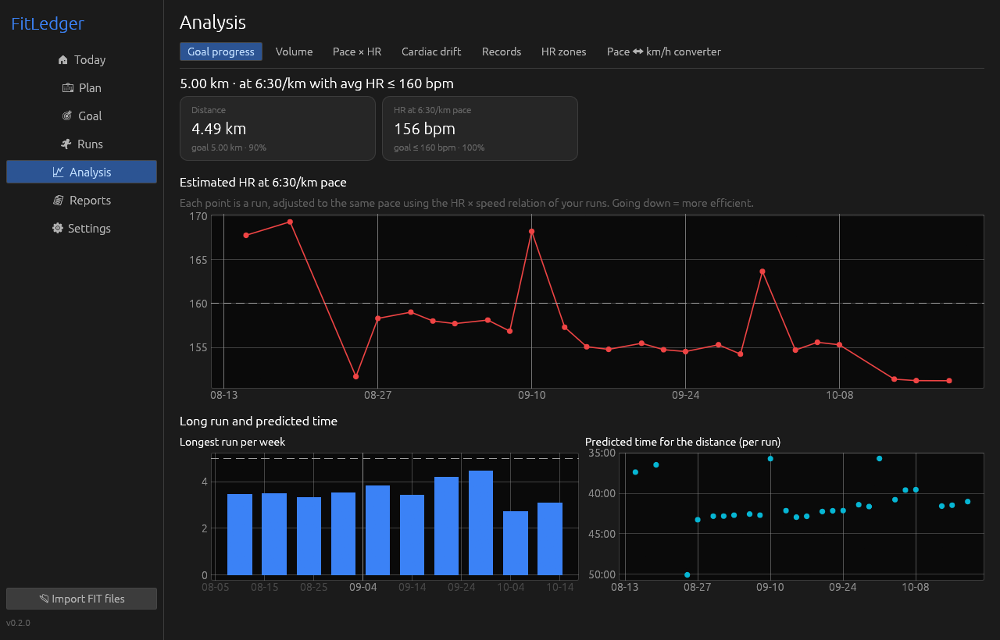
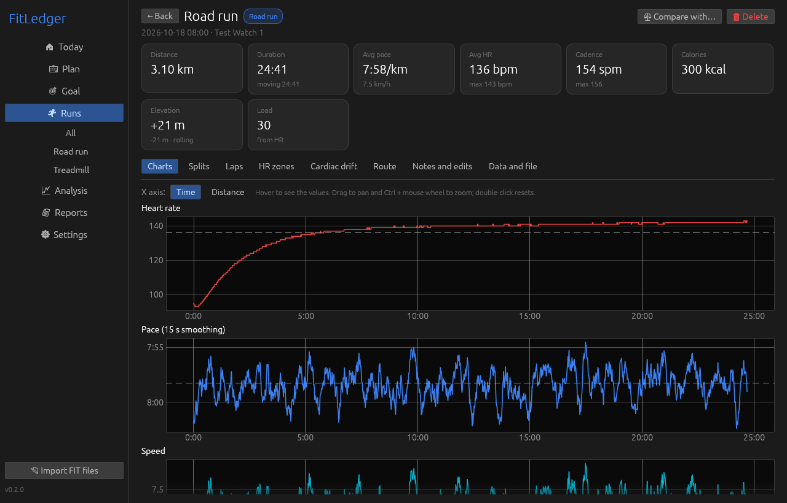
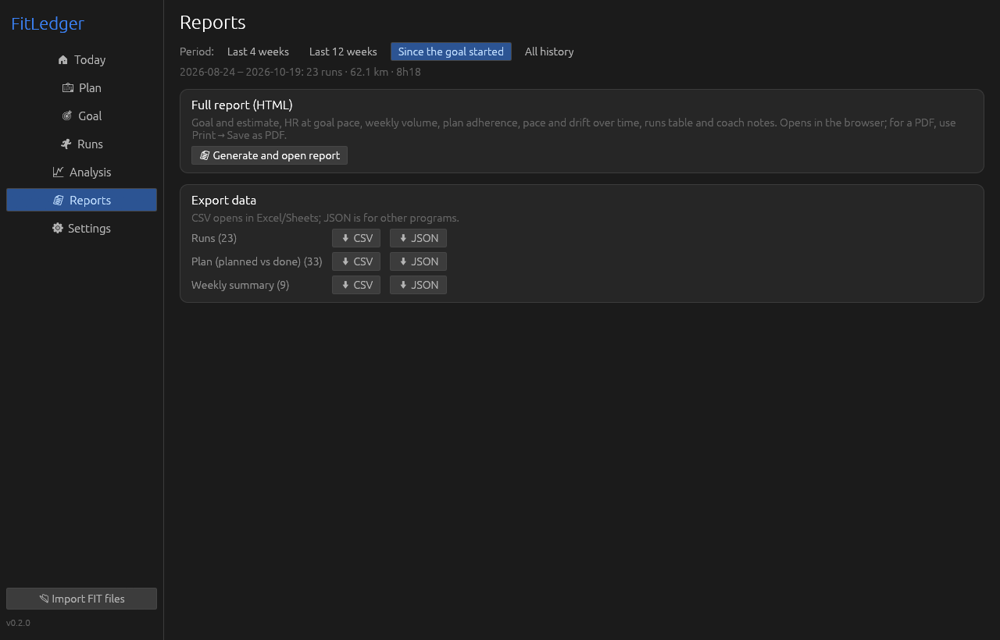

<p align="center"></p>

<h1 align="center">FitLedger</h1>

<p align="center">
<b>Your personal running coach for Windows.</b><br>
Tell it your goal. It builds your training plan — and rebuilds it after every run you import.
<br><br>
<a href="https://github.com/Antxj/FitLedger/releases/latest"><b>⬇ Download FitLedger.exe</b></a>
&nbsp;·&nbsp; Free and open source &nbsp;·&nbsp; No account, no cloud, no subscription
</p>



## Run lower. Run longer. Run faster.

Whether you want to **run 5 km for the first time**, **finish 10 km in under an hour**, or
**run at the same pace with a lower heart rate**, for goals **up to 10 km**, FitLedger turns that goal into a week-by-week
schedule built for *you* — from the runs your watch already records.

- **Set a goal in seconds.** Distance, and optionally a finish time, a maximum average heart rate,
  how many days a week you run, which days, and a target date. Change it anytime: the plan
  adjusts instantly and your history stays.
- **A plan that listens.** Import a run and the coach compares it with what was planned. Missed a
  session? Nothing is "made up". Easy runs too hard? Volume grows more slowly. Long run with high
  cardiac drift? It waits before getting longer. Logged high fatigue? The week gets lighter.
  Every change comes with the data that triggered it.
- **Heart-rate first.** Easy runs have a clear heart-rate cap from *your* zones, and every session
  shows the pace range **and the matching treadmill speed** — road or treadmill, you know exactly
  what to do.
- **Honest progress.** FitLedger models how your heart rate rises with speed, so it can tell you
  your estimated heart rate at goal pace, how fast it is dropping, your predicted finish time and
  a conservative estimate of when the goal is within reach.
- **Progress checks built in.** Every few weeks the plan includes a short check at goal pace —
  ideally on the treadmill, for identical conditions — so improvements are measured, not guessed.

| The plan | Goal progress | Every run, in detail |
|---|---|---|
|  |  |  |

## The science behind the plan

FitLedger's coach is built on well-established exercise science, applied conservatively:

| What the coach does | Based on |
|---|---|
| Heart-rate zones from your heart-rate **reserve**; easy runs capped at the top of zone 2 | Karvonen, Kentala & Mustala, *Ann Med Exp Biol Fenn* 1957 |
| Estimated maximum heart rate = 208 − 0.7 × age when you don't know yours | Tanaka, Monahan & Seals, *J Am Coll Cardiol* 2001 |
| Most of the training at low intensity; at most one harder session a week | Seiler & Kjerland, *Scand J Med Sci Sports* 2006 |
| Progress measured as **lower heart rate at the same pace** (progress checks + every run) | Buchheit, *Front Physiol* 2014 |
| Cardiac drift (aerobic decoupling) to judge long runs | Coyle & González-Alonso, *Exerc Sport Sci Rev* 2001 |
| Training load from duration and heart rate (TRIMP) | Banister, *Physiological Testing of the High-Performance Athlete* 1991 |
| Finish-time prediction for the goal distance | Riegel, *American Scientist* 1981 |
| Gradual weekly increases (big jumps raise injury risk in novice runners) | Nielsen et al., *JOSPT* 2014; Buist et al., *Am J Sports Med* 2008 |
| Phases and a lighter week every fourth week | Issurin, *Sports Med* 2010 |

Some numbers are FitLedger's own conservative choices rather than findings of a specific study:
weekly time grows at most 8% and the long run about 10%; with no trend yet it assumes an
improvement of 0.8% a week in time and 0.4 bpm a week in heart rate; it warns about drift above 8%
or easy runs spending more than 30% of the time above zone 2. Your own data replaces these
assumptions as you run. The full list, with complete references, is in the app under
*Plan → Scientific basis*.

## Everything your runs can tell you

- **Automatic import** of `.fit` files: drop them in the `fits` folder next to the app and they are
  imported every time it opens. Duplicates are detected, broken files never stop the others, and
  your original files are never modified.
- **Detailed runs:** linked charts of heart rate, pace, speed, cadence, altitude and power (hover
  to read any value), splits by 500 m / 1 km / mile / any distance, laps, heart-rate zones,
  cardiac drift, the route and a data-quality report that flags bad sensor readings without
  deleting anything.
- **Analysis:** goal progress, weekly volume and plan adherence, pace × heart rate over time,
  cardiac drift trend, personal records (road and treadmill kept apart), zones and a
  pace ↔ km/h converter.
- **Comparisons** of two or more runs, with warnings when conditions differ (treadmill vs road,
  hills, distance, temperature).
- **Reports:** a polished HTML report for any period — goal, projection, charts, adherence and every
  run — ready to print to PDF, plus **CSV and JSON** exports of runs, the plan and weekly totals.



## Private by design

- Everything stays on your computer. **No telemetry, no account, no cloud.**
- Routes are drawn from your GPS points without downloading any map.
- The only network request is the update check: when the app opens (and once a day after that) it
  asks GitHub whether a new version exists. You can turn it off in *Settings*. Updates are only
  installed when you click, after the file's SHA-256 is verified.
- Portable: the app and your data live in one folder you control. Make a backup with one click.

## Getting started

1. Download `FitLedger.exe` from the [latest release](https://github.com/Antxj/FitLedger/releases/latest)
   and put it in a folder of its own where you can write files (for example `Documents\FitLedger`).
2. Open it. A short setup asks for your age and heart rate (for your zones), imports your runs
   and helps you set your first goal.
3. After each run, copy the `.fit` file from your watch app into the `fits` folder (or use
   *Import FIT files*). The plan updates itself.

Works with `.fit` files from Garmin, Coros, Zepp/Amazfit, Suunto and other watches that export FIT.
English and Portuguese (detected automatically), light and dark themes (follows Windows).

The executable is not code-signed yet, so Windows SmartScreen may show a warning the first time
(*More info → Run anyway*). Each release lists the file's SHA-256, and you can verify where it was
built:

```bash
gh attestation verify FitLedger.exe --repo Antxj/FitLedger
```

> FitLedger gives training guidance based on your recorded runs. It is not medical advice —
> check with a doctor before starting a new training program.

## For developers

Built in Rust with [egui](https://github.com/emilk/egui) and SQLite; a single portable executable.
Requirements: Rust (stable, GNU toolchain) and MinGW-w64 (`gcc`, `windres`).

```bash
cargo test
```

```bash
powershell -ExecutionPolicy Bypass -File build-release.ps1
```

`build-release.ps1` runs the tests, builds the executable without local paths inside, checks it and
prints its SHA-256 — the same script GitHub Actions uses for releases. `tools/screenshots.py`
regenerates the screenshots from made-up demo data (`FITLEDGER_DEMO=1`).

## License

GPL-3.0-or-later — see [LICENSE](LICENSE). Third-party components:
[THIRD-PARTY-LICENSES.txt](THIRD-PARTY-LICENSES.txt). Security reports: [SECURITY.md](SECURITY.md).
