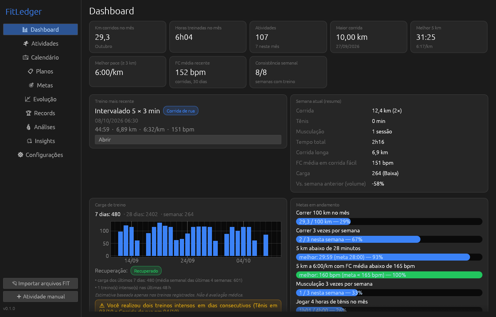
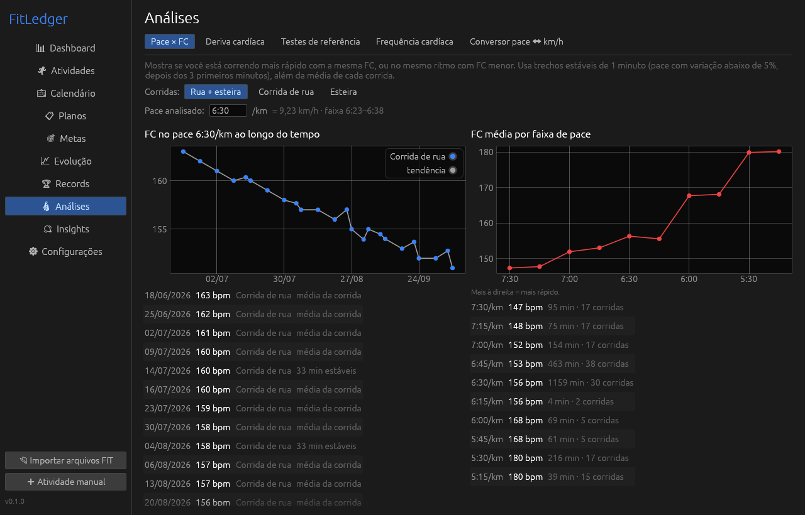
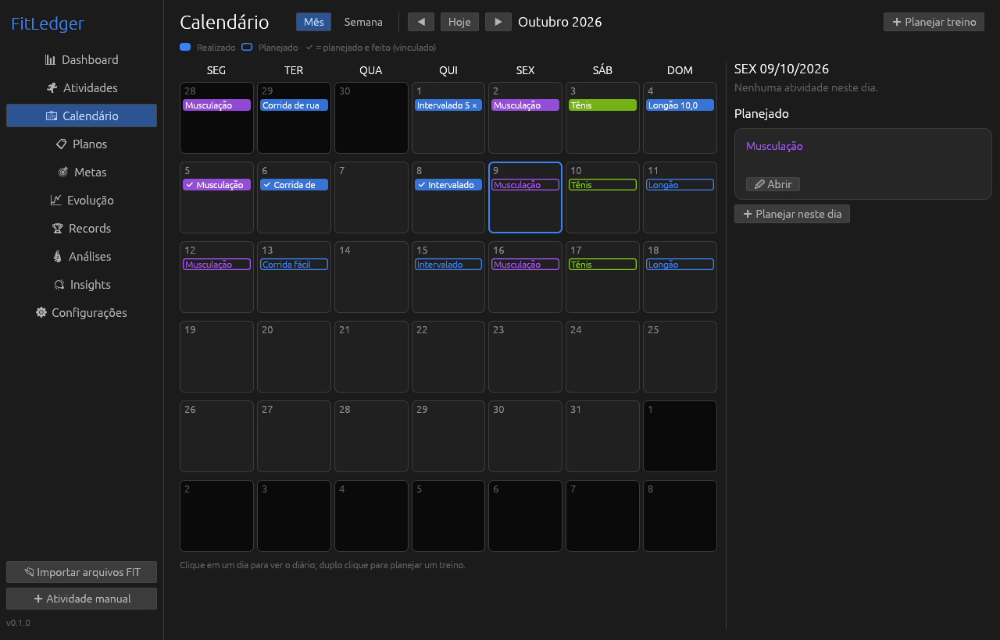
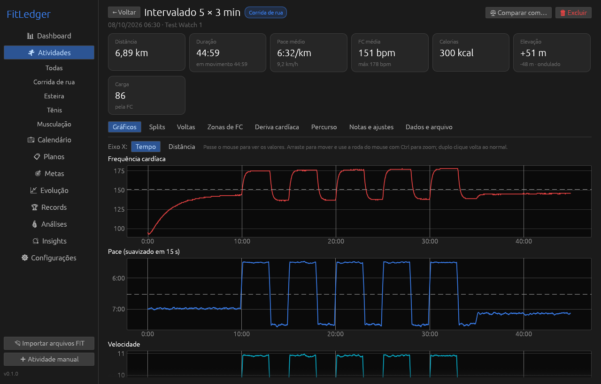
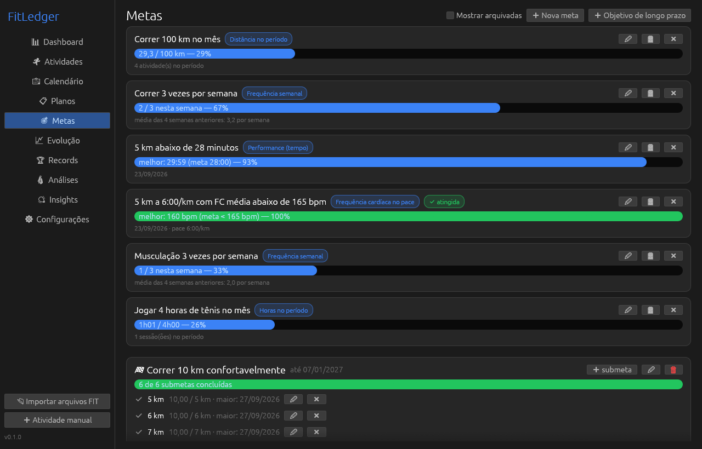
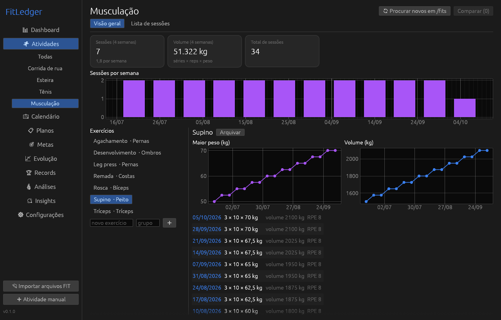
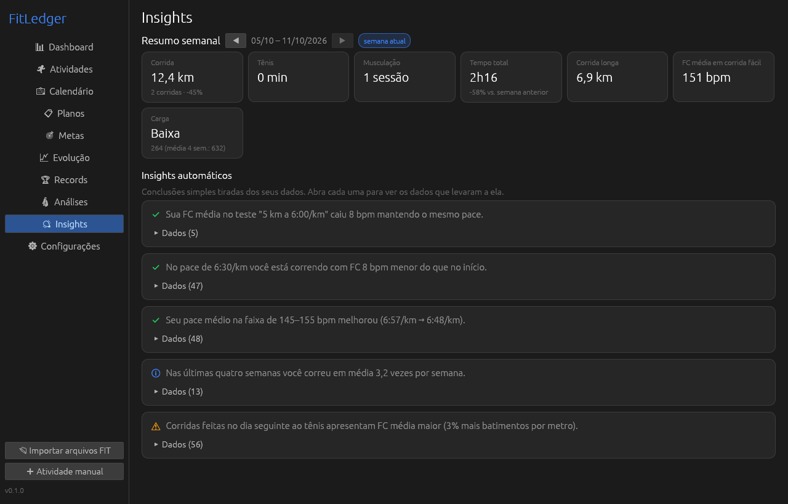

<p align="center"></p>

<h1 align="center">FitLedger</h1>

<p align="center">
Diário esportivo local para Windows: lê os arquivos <code>.fit</code> do seu relógio e transforma
em análises de corrida de rua, esteira, tênis e musculação — evolução, metas e planos.
<br><br>
<a href="https://github.com/Antxj/FitLedger/releases/latest"><b>⬇ Baixar o FitLedger.exe</b></a>
&nbsp;·&nbsp; <a href="README.md">Read in English</a>
</p>



## O que ele faz

- **Importação automática de FIT.** Coloque os arquivos `.fit` na pasta `fits`, ao lado do
  `FitLedger.exe`. Os novos são importados sempre que o app abre (ou use *Importar arquivos FIT*).
  Duplicatas são detectadas, um arquivo com defeito não impede os outros e os originais nunca são
  alterados.
- **Tudo o que o relógio gravou:** FC, pace, velocidade, cadência, altitude, GPS, potência,
  temperatura, voltas e pausas. O arquivo original também fica guardado no banco.
- **Detalhe da atividade:** gráficos ligados entre si (passe o mouse para ver os valores), splits
  por 500 m, 1 km, milha ou qualquer distância, voltas, zonas de FC, deriva cardíaca, percurso e
  relatório de qualidade dos dados.
- **Pace × FC:** mostra se você está correndo mais rápido com a mesma FC, ou no mesmo ritmo com FC
  menor. Usa trechos estáveis de 1 minuto, agrupados por faixa de pace, ao longo do tempo.
- **Deriva cardíaca (desacoplamento Pa:FC)** e **testes de referência** (ex.: 5 km a 6:00/km na
  esteira a 1%), com a FC de cada km em cada execução.
- **Esteira** separada da rua, com inclinação e distância corrigida.
- **Carga de treino:** TRIMP pela FC, ou RPE × minutos quando não há FC. Mostra a carga de 7 e de
  28 dias, avisos simples e uma estimativa de recuperação. O tênis conta: um jogo intenso não é dia
  de descanso. *Não faz diagnóstico médico.*
- **Planos e calendário:** modelo semanal, planejado × realizado, intervalados com blocos
  repetidos e a velocidade da esteira para cada pace alvo.
- **Metas:** distância, frequência, tempo, FC no pace, maior distância e horas. Também há
  objetivos de longo prazo com submetas.
- **Musculação** (séries × repetições × peso, histórico e volume por exercício) e área de **tênis**.
- **Evolução, records, resumo semanal e insights.** Cada insight mostra os dados que levaram a ele.
- **Comparação** de duas ou mais atividades, com avisos sobre esteira × rua, relevo, distância e
  temperatura.
- **Backup e restauração** (um arquivo `.fitledger`), **exportação em CSV e JSON**, português e
  inglês, tema claro e escuro.

| Pace × FC | Calendário | Atividade |
|---|---|---|
|  |  |  |
| **Metas** | **Musculação** | **Insights** |
|  |  |  |

*As imagens usam dados de demonstração inventados.*

## Como começar

1. Baixe o `FitLedger.exe` na [versão mais recente](https://github.com/Antxj/FitLedger/releases/latest).
   Coloque-o numa pasta só dele, onde você possa gravar arquivos (ex.: `Documentos\FitLedger`), e
   não em `Arquivos de Programas`.
2. Abra o programa. Ele cria duas pastas ao lado do executável:
   - `fits\`: copie aqui os seus `.fit` (exportados de Garmin, Coros, Zepp/Amazfit, Suunto, Polar…);
   - `data\`: o seu histórico (`fitledger.db`) e os backups automáticos.
3. **Apagar a pasta do aplicativo apaga o histórico.** Use *Configurações → Criar backup* de vez em quando.

O executável ainda não tem assinatura digital, então o SmartScreen do Windows pode avisar na
primeira vez (*Mais informações → Executar assim mesmo*). Você pode conferir o arquivo pelo SHA-256
que está nas notas da versão, ou verificar onde ele foi compilado:

```bash
gh attestation verify FitLedger.exe --repo Antxj/FitLedger
```

## Privacidade

- Tudo fica no seu computador. **Sem telemetria, sem conta e sem nuvem.**
- O único acesso à rede é a verificação de atualizações: uma vez por dia o app consulta a API
  pública do GitHub para ver a versão mais recente. Isso pode ser desligado em *Configurações*. A
  atualização só é instalada quando você clica, depois de conferir o SHA-256 publicado pelo GitHub.
- O percurso é desenhado a partir dos pontos de GPS, sem baixar nenhum mapa.

## Como compilar

Requisitos: Rust (stable, toolchain GNU) e MinGW-w64 (`gcc` e `windres`, por exemplo do MSYS2).

```bash
cargo test
```

```bash
powershell -ExecutionPolicy Bypass -File build-release.ps1
```

O `build-release.ps1` roda os testes, compila o `target\release\fitledger.exe` sem caminhos locais
dentro do binário, confere o resultado e mostra o SHA-256. É o mesmo script usado no GitHub Actions.

Variáveis de ambiente úteis para desenvolvimento:
- `FITLEDGER_HOME`: pasta base no lugar da pasta do .exe;
- `FITLEDGER_DEMO=1` com `FITLEDGER_SCREENSHOTS=<pasta>`: dados falsos e capturas de tela (veja `tools/screenshots.py`);
- `FITLEDGER_LANGUAGE=pt|en`: força o idioma.

## Licença

GPL-3.0-or-later. Veja o [LICENSE](LICENSE). Componentes de terceiros estão em
[THIRD-PARTY-LICENSES.txt](THIRD-PARTY-LICENSES.txt). Para problemas de segurança, veja o
[SECURITY.md](SECURITY.md).
